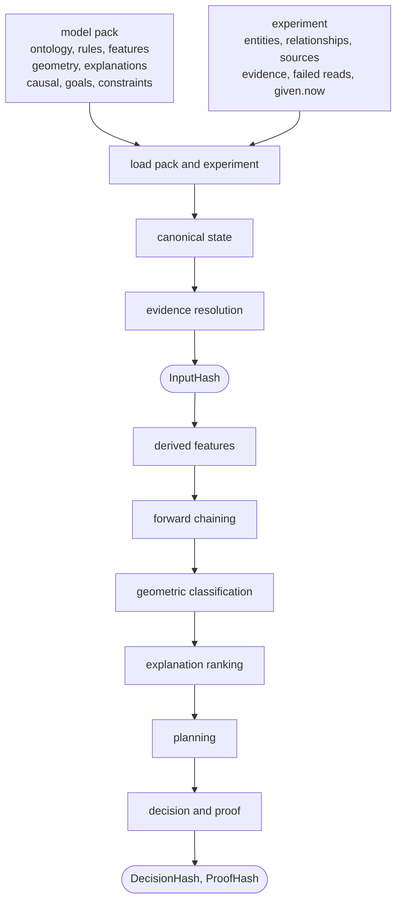

# DRE: Deterministic Reasoning Engine

DRE is a reasoning engine that reaches the same conclusion from the same input every time and records the derivation of every step.

It takes a model pack, a set of YAML files describing a domain, and an experiment, a frozen snapshot of what is known about one situation. It produces a decision, a plan and a proof. No language model is involved in the decision path. The decision path has no sampling, no floating point, no clock reading and no hash-map iteration order, so repeated runs give one decision hash and one proof hash.

```text
SameInput + SameModel + SameEngine = SameDecision
```

## What it is for

Domains where a decision may have to be defended later against the exact evidence available at the time: diagnosis, safety interlocks, release gating, chain-of-custody and admissibility, incident triage.

- Three-valued logic throughout. A condition is true, false or unknown, and unknown propagates instead of collapsing to false. A rule that cannot be decided does not fire, and the proof records that it was tried. Where sources disagree the engine reports `CONFLICTING`.
- Every conclusion carries its derivation. The proof graph records each rule that fired, what it read and what it wrote. `--why` prints only the steps the answer rested on.
- Any past decision can be re-run exactly. Records commit five hashes to disk, and replay names which one moved if the engine, the model or the input changed.

The engine is domain-agnostic. Everything it knows arrives in a model pack, and packs are data, not code.

## Capabilities

| Capability | What it does |
|---|---|
| Symbolic inference | Forward chaining to a fixed point over three-valued logic, with eight epistemic statuses that distinguish unknown from unobservable, not applicable, stale, invalid and conflicting. A declared value precedence order settles two rules that conclude different values |
| Derived features | Fixed-point arithmetic over properties, with guards, so a pack can compute a margin or a ratio and reason about the result |
| Evidence resolution | Multiple sources per property, each limited by declared reliability, with independence groups so three sensors on one bus count once, and freshness windows |
| Declared traversal | Follow a declared relationship, read a property on what is reached, and collapse the result with a mandatory quantifier: `every`, `some`, `the` or `at_least: N` |
| Geometric classification | Declared spaces and regions, containment and boundary distance over computed axes |
| Planning | BFS, Dijkstra and A* over declared actions toward declared goals, with hard and soft constraints and a per-constraint policy for undecidable inputs |
| Explanation ranking | Declared competing hypotheses scored against the observed state, separately from the planner |
| Active evidence gathering | `survey` re-runs an experiment for each candidate value of every unknown the ontology closes, and reports which single measurement would most change the decision and which cannot change it |
| Counterfactuals | A perturbed input re-run to show what changes |

## How a run works

Every stage is a pure function of what preceded it. No stage reads the network, a random number or a clock. The harness times the run for its metrics, and nothing it measures re-enters the reasoning path.



Only the manifest is parsed when a pack loads. Every other section is held as bytes and parsed by the stage that owns it.

`InputHash` is taken after evidence resolution and before feature derivation, so the engine's own work is never folded into the description of the problem.

| Hash | Covers | Moves when |
|---|---|---|
| `InputHash` | The state as given | The situation differs |
| `ModelHash` | The bytes of the pack's section files and the manifest's identity fields | The domain description changes |
| `EngineHash` | Engine version and runtime configuration | The engine changes what it accepts, decides or hashes |
| `DecisionHash` | The reasoned state and the plan | The conclusion differs |
| `ProofHash` | The full derivation | The route to the answer changed, even if the answer did not |

## Requirements

- Rust 1.97.1. `rust-toolchain.toml` pins it and `rustup` fetches it.
- Python 3 for the offline helpers in `tools/` (line-ending check, pack generators).
- A Unix shell for `tools/restart-conformance.sh`. The engine and its tests build and run on Linux; CI runs on a hosted Ubuntu runner.

## Build and test

```bash
cargo build --workspace
```

```bash
cargo test --workspace
```

```bash
cargo clippy --workspace --all-targets -- -D warnings
```

Model packs are hashed over their raw bytes, so a pack must keep LF line endings. `.gitattributes` pins them, and `python3 tools/check-line-endings.py` checks that the pin held.

## Use

```bash
cargo run --bin dre -- run experiments/diagnosis-002.yaml --why
```

`--why` prints the steps the conclusion rested on and `--proof` prints the whole trace. The other commands:

| Command | Purpose |
|---|---|
| `run` | Run an experiment and report its decision and hashes; `--record` writes a replay record |
| `replay` | Re-run an experiment and verify it against its stored record |
| `explain` | Rank the declared hypotheses against the observed state |
| `survey` | Rank the unknowns by what resolving each would change |
| `counterfactual` | Perturb an input and report what changes |
| `validate` | Check a model pack, optionally against an experiment |
| `benchmark`, `history` | Measure a run and read stored results |
| `engine` | Print the engine version and hash |

```bash
cargo run --bin dre -- explain  experiments/device-cascade-abduction-001.yaml
cargo run --bin dre -- survey   experiments/checkout-layer-diagnosis-001.yaml
cargo run --bin dre -- validate model-packs/checkout-layer-diagnosis
cargo run --bin dre -- replay   experiments/diagnosis-002.yaml
```

## Status

The engine version is 0.22.0. It moves whenever reasoning behavior changes, because `EngineHash` covers the version and a record made under one behavior must not verify against another. The history of those changes is in [docs/decisions.md](docs/decisions.md).

The repository holds 27 model packs and the experiments under `experiments/`, each with a committed replay record. The determinism conformance suite in `crates/dre-conformance` runs as part of `cargo test --workspace`: randomized input and rule ordering, repeated execution, concurrency, thread-count invariance, round-trip serialization and checkout location. A machine-restart check lives in `tools/restart-conformance.sh`.

Planned work and ruled-out designs are in [docs/roadmap.md](docs/roadmap.md).

## Layout

```text
crates/          engine crates, one per phase
  dre-core         deterministic runtime foundation
  dre-state        canonical state
  dre-model        model pack format
  dre-symbolic     symbolic reasoning and derived features
  dre-evidence     evidence resolution
  dre-geometry     geometric classification
  dre-causal       causal actions
  dre-explain      explanation ranking
  dre-planner      constraints, goals, search
  dre-proof        proof graph
  dre-replay       replay records
  dre-lab          the `dre` CLI
  dre-conformance  determinism conformance suite

model-packs/     reasoning domains, no engine code
experiments/     experiment definitions and committed replay records
benchmarks/      benchmark metric definitions
schemas/         why the checks live in code rather than schema files
tools/           offline helpers, never in a decision path
docs/            plan, roadmap, determinism rules, decisions, verification
```

## Documentation

| Document | Contents |
|---|---|
| [docs/mvp-plan.md](docs/mvp-plan.md) | The specification, kept in sync with the code |
| [docs/decisions.md](docs/decisions.md) | Design decisions and their reasoning |
| [docs/determinism.md](docs/determinism.md) | The determinism prohibitions and which are enforced mechanically |
| [docs/verification.md](docs/verification.md) | How to check the guarantees, including checks `cargo test` cannot make |
| [docs/engineering-notes.md](docs/engineering-notes.md) | Build and test practice, and engineering traps with their fixes |
| [docs/roadmap.md](docs/roadmap.md) | Build order, planned work and ruled-out designs |
| [docs/external-pack-brief.md](docs/external-pack-brief.md) | A guide for writing a model pack from scratch |
| [docs/external/](docs/external) | Design analyses of possible extensions |
| [model-packs/README.md](model-packs/README.md) | The model pack format |

## License

MIT. See [LICENSE](LICENSE).
